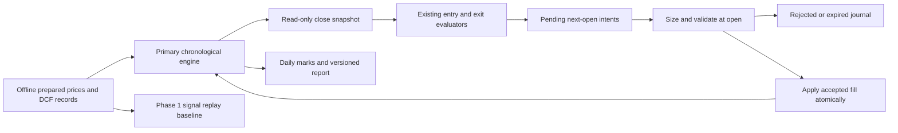

# Phase 1.5: execution-coupled primary backtesting architecture

Status: proposed architecture, awaiting approval. Drafted: 2026-10-10; finalized: 2026-10-11. No implementation or commit is authorized by this document.

## 1. Executive summary

Build a dedicated, synchronous primary simulation loop (Option B). Evaluate the existing primary strategy at each session close against **actual filled holdings and current marked equity**. Queue intents for a later open. Only a successful simulated fill may change cash, holdings, cost basis, or position-specific stop/target state. A rejection leaves the account unchanged and permits a new decision at a later close.

Keep Phase 1's vectorbt signal replay available unchanged as a named baseline. Borrow chronological-ledger patterns from the swing simulator, but do not call its strategy, sizer, or intraday exit evaluator. Do not rewrite production evaluators or add production broker dependencies to the simulator.

Key decisions in this proposal:

- One portfolio timeline, long-only, unlevered, one filled position and at most one pending intent per symbol.
- Close-based primary decisions; next-session open fills. **No primary intraday stop fills.** This preserves the existing historical primary rule, not broker protective-order behavior.
- At an open, execute previously queued sells alphabetically, then buys alphabetically. Only completed opening sales can fund that opening's buys.
- Allocate each buy a fraction of remaining cash, inclusive of transaction costs. Use current equity for the existing entry eligibility check. Do not import swing stop-distance sizing.
- Explicit data quality, order status, window, schema, and comparison policies below. Existing live risk defaults remain unchanged; this is not a live-risk parity project.
- Offline prepared inputs are the simulator boundary. No provider, broker, LLM, database, or wall-clock calls inside the loop.

## 2. Verified current architecture

### Repository evidence

Active branch verified: `feature/backtest-execution-coupling`. HEAD and local main both resolve to `a033771841bcb9e7f55a0ba68f05377199e51c3d`. `git merge-base --is-ancestor` confirms that Phase 1 commit is an ancestor (indeed HEAD itself). Initial status contains only unrelated untracked `PROJECT_HISTORY.md`; preserve it. No fetch, pull, push, merge, rebase, remote query, dependency installation, or broker operation was performed during this architecture task. Remote main's present state is intentionally unknown.

Sources inspected include both audit reports, all five backtesting modules, entry/exit signals and risk, swing sizing/configuration/confirmation/exits/calendar, historical fundamentals and DCF, market-data and indicator modules, all five Phase 1 regression/audit test files, and installed vectorbt source. File references here identify symbols rather than relying on stale line numbers.

### Actual primary call path

`run_watchlist_backtest.main()` → `get_company_name(ticker)` → `generate_signals(ticker, company_name, outputsize=5000)` → `fetch_ohlcv` → `compute_indicators` + `rolling_support_resistance` → `get_point_in_time_fair_values` → date loop with assumed `in_position` → shifted `(opens, entries, exits)` → independent `summarize_ticker_backtest` and shared `run_shared_capital_backtest` → vectorbt `Portfolio.from_signals` → `summarize`.

The opens Series carries a closing-mark Series in `attrs['close_data']`. Shared replay intersects symbol indexes; independent reports segment continuous equity. The driver currently prints progress and JSON; it is not a stable JSON-only protocol.

| Existing symbol/signature | Verified behavior | Proposed treatment |
| --- | --- | --- |
| `generate_signals(ticker, company_name, outputsize=5000)` | Assumes holdings before fills; uses static `STARTING_CAPITAL`; shifts entry and exit flags one bar | Retain for baseline; coupled mode uses a new per-close adapter |
| `run_backtest(price_data, entries, exits, initial_cash=STARTING_CAPITAL, max_position_pct=None, fees=None, slippage=None, close_data=None)` | Percent of remaining cash; vectorbt determines holdings independently | Retain unchanged |
| `summarize_ticker_backtest(ticker, price, entries, exits, initial_cash=STARTING_CAPITAL, n_windows=4)` | Continuous equity segments, not independent resets | Retain legacy schema |
| `run_shared_capital_backtest(signals_by_ticker, initial_cash=STARTING_CAPITAL)` | Shared cash, alphabetical columns, common-date intersection | Retain unchanged as replay baseline |
| `_technical_proxy(row)` | Down if close < SMA50, else up; close entry reference, rolling support/target, probability 45/55 | Reuse unchanged through a documented adapter dependency |
| `evaluate_entry(ticker, valuation_result, technical_result, sentiment_score, max_position_pct, account_equity)` | Requires filing provenance, non-down trend, nonnegative sentiment, discount `(fair_value-price)/price >= .20`, equity × allocation >= $1 | Reuse unchanged; pass current closing equity |
| `evaluate_exit(ticker, entry_price, current_price, stop_loss_price, take_profit_price)` | Stop first, then target, evaluated against supplied current price; no actual time-exit rule; entry_price currently unused | Reuse unchanged at close with actual position levels |
| `Limits.from_env()` | Validates max trade $100, entries/day 3, exposure .30, allocation .10, daily loss .02 defaults | Resolve once at input boundary; only allocation belongs to current replay sizing |
| `get_point_in_time_fair_values(ticker, company_name)` | Calls SEC/context/LLM per filing; rejects nonpositive/nonfinite or non-filing values; NaN invalidates older DCF | Baseline stays unchanged; new offline typed observations retain provenance |
| `fair_value_asof(fair_values, date)` | Strictly earlier filing date; latest observation, including invalidation | Reuse policy; typed adapter adds date normalization and metadata |
| `fetch_ohlcv(ticker, interval='1day', outputsize=100)` | Twelve Data request; sorted DatetimeIndex, float OHLCV | Preparation boundary only; never loop dependency |
| `compute_indicators(df)` / `rolling_support_resistance(df, window=50)` | pandas-ta SMA/RSI/MACD/Bollinger plus trailing support/resistance | Reuse on copies; require prefix-invariance tests |
| `get_annual_filings(ticker)` / `get_financial_summary_asof(ticker, as_of, years=3)` | SEC companyfacts assembled into period-end records; outer filing-date filter | Not sufficient to certify per-fact historical provenance; see §10 |
| `run_dcf(ticker, company_name, filing_context, n_years=5)` | Anthropic-generated valuation assumptions and output, currently model string `claude-sonnet-5` | Preserve prompt/formula; consume captured outputs, no calls in simulation |

Swing path: `run_swing_backtest.main()` → `compare_variants(tickers_with_names, base_config, outputsize=5000, account_equity=100000, n_windows=4, variants=None, fetch_pause_seconds=0)` → cached `_prepare_ticker` / `_find_raw_candidates` → `report_prepared` → `_simulate_tickers(ticker_dfs, raw_candidates_by_ticker, config, account_equity, *, fees=None, start=None, end=None)` → daily shared ledger and independent flat-start windows. `SimulationResult` supports old five-value tuple unpacking as well as equity/open-holding fields.

Swing uses `size_position(*, account_equity, cash_available, entry_price, stop_price, open_risk_dollars, config, min_trade_increment=.0001, buying_power=None)` and `evaluate_swing_exit_bar`. It reserves stop-distance risk, processes entries before exits, and permits same-session intraday stop outcomes. These are **not** primary policies.

A repository search found no backtest-report consumers in `api/` or `dashboard/`; do not infer that external consumers do not exist. Production `execute_buy` also applies account-wide limits and whole-share checks absent from historical replay; do not call it to simulate orders.

## 3. Root cause of the execution-coupling problem

There are two position authorities: `generate_signals.in_position` and vectorbt's filled position state. The former changes on a decision; the latter changes on a fill. Cash rejection, competing symbols, clipping histories, or nonfills can separate them. Stops/targets and later eligibility then describe an imagined holding. Changing signal-array shifting or adding more portfolio metrics cannot repair that causal mismatch.

Remove assumed position state only from the new path. Position presence is `state.positions.get(symbol)`, pending presence is `state.pending.get(symbol)`, and both are consulted at decision time. Filled position levels come from the entry intent that actually filled. Precompute only state-independent market features, never a complete sequence of state-dependent decisions for the coupled engine.

## 4. Evaluated implementation alternatives

| Option | Evidence and advantages | Cost/risk | Decision |
| --- | --- | --- | --- |
| A: adapt swing simulator | Already chronological; daily equity, cash/risk constraints, costs and strong audit fixtures | Its candidates, confirmation, stop-risk sizer, entry-before-exit sequence, and intraday exits encode swing behavior. Generalizing requires invasive regression-sensitive edits | Reject direct reuse in Phase 1.5; borrow patterns and test fixtures only |
| B: dedicated primary simulator | Direct calls to existing Python evaluators, explicit orders and rejection journal, small single-authority ledger | Duplicates some accounting mechanics; requires analytical and differential tests | **Recommend**; isolate first, consider extraction only after both contracts stabilize |
| C: vectorbt order callbacks | Installed API supports current state and fill feedback, avoiding a new framework | Open/close phases, pending intents and typed Python strategy results still need orchestration; JIT and callback contracts complicate auditing | Technically viable, not selected for this phase; preserve vectorbt for baseline/reference arithmetic |

### Installed vectorbt evidence (local inspection, not an assumed capability)

`venv/bin/python` reports vectorbt **1.0.0**. Inspected `Portfolio.from_order_func` in `venv/lib/python3.12/site-packages/vectorbt/portfolio/base.py` and context types/simulation code in `portfolio/enums.py` and `portfolio/nb.py`.

Verified parameters include `order_func_nb`, `post_order_func_nb`, `pre_row_func_nb`, `post_row_func_nb`, `pre_segment_func_nb`, `cash_sharing`, `group_by`, `row_wise`, `use_numba`, `flexible`, `call_seq`, and `update_value`. `OrderContext` exposes `cash_now`, `position_now`, `free_cash_now`, `value_now`, and the last cash/position/value arrays. `PostOrderContext` contains before/after state and `order_result`; `OrderResult` has size, price, fees, side, status, status_info. Statuses include Filled, Ignored and Rejected, with reasons including CantCoverFees and MinSizeNotReached. `order_nb` supports fees, slippage, size granularity and `allow_partial`.

The installed simulation code invokes `post_order_func_nb(post_order_ctx, *pre_segment_out, *post_order_args)`; use the actual context contract, not a guessed extra positional result argument. `use_numba=False` selects the Python simulation implementation; JIT mode asserts compiled callback functions. Thus Python evaluators are possible without porting them, but callback composition would remain necessary. Option C is rejected for clarity and maintenance, **not** because callbacks or fractional sizing are unsupported. No prototype engine was implemented to evaluate this option.

## 5. Recommended architecture and rationale

Introduce a primary-only ledger with immutable input/configuration and mutable state owned solely by its engine. Keep small pure functions for sizing, fill arithmetic and reporting; do not create a universal trading framework or refactor swing.



Proposed files and exact interface contracts (descriptions, not implementation):

| File | Interface to add | Responsibility |
| --- | --- | --- |
| `backtesting/primary_state.py` | `PrimarySimulationConfig`, `PreparedPrimaryData`, `PortfolioState`, `Position`, `OrderIntent`, `Fill`, `OrderOutcome`, `SimulationResult` | Data contracts in §7, frozen config and read-only decision views |
| `backtesting/primary_inputs.py` | `prepare_primary_data(prices_by_symbol, valuation_records, *, session_index, metadata) -> PreparedPrimaryData` | Validate offline input, compute unchanged indicators on copies, normalize dates, hash snapshot; never fetch |
| `backtesting/primary_strategy.py` | `evaluate_close(symbol, observation, portfolio_view, config) -> DecisionRecord` | One close decision from actual state; wraps existing evaluators and proxy |
| `backtesting/primary_simulator.py` | `simulate_primary(data, config, *, start=None, end=None) -> SimulationResult`; `size_entry(intent, open_snapshot, config) -> FillProposal or Rejection`; `apply_fill(state, fill) -> None`; `assert_invariants(state) -> None` | Event loop, deterministic fills and state transitions |
| `backtesting/primary_reporting.py` | `summarize_primary(result) -> dict`; `compare_primary_runs(baseline_report, coupled_result, manifest) -> dict` | Schema and reconciliation; no alternate execution ledger |
| `backtesting/primary_windows.py` | `run_primary_windows(data, config, boundaries) -> list[SimulationResult]` | Fresh state per explicit window |
| `backtesting/run_primary_backtest.py` | `main(argv=None)` | New offline CLI with engine choice and saved inputs; old drivers remain unchanged |

Do not modify existing implementations in the initial Phase 1.5 build. Import reusable metrics validators, `_technical_proxy`, and evaluators; their private dependency is intentional and covered by parity tests. New loader uses only prepared snapshots; existing fetching/DCF tools remain separately authorized preparation work. No engine input parameter may be a broker client or callable provider.

## 6. Chronological event lifecycle

Session timestamps are logical `(exchange_session_date, phase, sequence)` with phases OPEN then CLOSE; they do not invent exact exchange times or half-day closing hours. All fills must have a strictly later session date than their signal. Sort normalized uppercase symbols once; reject aliases that collide after normalization.

**For every session in the supplied canonical session index, within run bounds:**

1. **Pre-open:** use only prior state, yesterday's queued intents, and historical records already available. No today's high, low, close, volume or close-derived indicators are exposed to order execution.
2. **Open marks:** update held symbols to valid current opens. Carry their last mark if a bar is absent and label it stale. No price is invented before the first observed bar. Compute pre-fill equity and exposure. Stale held marks block new buys for that session; valid sales remain permitted.
3. **Resolve pending sells, alphabetically:** verify current holding and valid open, sell its full quantity with adverse slippage/fees, then atomically remove holding and credit proceeds. There is no future lifecycle scan. Invalid state is an invariant error; absent bar expires the order as below.
4. **Resolve pending buys, alphabetically:** re-read cash after each completed fill, use only current-open/prior-close marks for constraints, calculate affordable quantity and either fill or reject. No signal is regenerated at the open. Entry valuation/trend is frozen at the signal close; no new gap valuation gate is introduced. Opening sales are already settled in the simulation and may fund these buys (instant settlement assumption, not real cash-account settlement parity).
5. **Intraday:** no new primary action. A high/low crossing alone does not trigger a primary stop. Do not invoke `evaluate_swing_exit_bar`. This deliberately retains the primary's close-based historical decision semantics.
6. **Close marks:** update held symbols with valid closes and retain flagged prior marks for missing bars. Compute one closing equity snapshot, exposure, unrealized P&L, cash and mark-age information. All symbols' new decisions use that same snapshot, not sequential fictional reservations.
7. **Close decisions, alphabetically:** for each symbol with a valid completed bar, pass only the current row/available valuation and actual portfolio view to §8. Exits do not require DCF or indicator warmup. Store any next-open intent without altering cash/holdings. A newly filled entry can generate an exit at its entry-day close; its earliest exit is a later open. A sale filled this morning restores eligibility for a buy decision this close, filling no earlier than a later open.
8. **Boundary/journal:** append the closing snapshot and decision records; assert invariants. At terminal close, expire all remaining intents with `end_of_window` (or `end_of_dataset` for the full run), including intents just generated. Retain open positions at last known mark, explicitly indicating stale marks. Do not force liquidation or import the next bar merely to close trades.

### Missing sessions and order lifetime

`session_index` is an explicit sorted, unique list of market-session dates from an offline snapshot. Validate each supplied symbol bar is a member. Prefer an archived exchange calendar; absent one, the input adapter may explicitly use the union of observed dates with `calendar_source='observed_union'`. Neither `bdate_range` nor an Alpaca calendar call is the production loader fallback. Holidays with no session do not expire orders. An observed-union calendar cannot identify a date missing from every symbol; flag that limitation in the manifest.

An intent lives until the **next canonical session open**, not the next convenient symbol bar. If the symbol has no bar then, expire it with `missing_execution_bar`, retaining any existing holding. Never forward-fill execution prices. At a subsequent valid close the strategy may issue a fresh intent. Missing close means no fresh signal for that symbol. Invalid supplied finite/positive/OHLC geometry fails preparation instead of silently dropping a row. Missing rows are allowed and recorded; invalid rows are not.

Sell-before-buy differs from vectorbt's per-column ordering and swing's entry-first policy. It is explicit and defensible because both orders were decided before the session and sale fills have completed. Differential reports must identify ordering as a possible source of divergence. No entry may use an exit signal generated at today's close, tomorrow's proceeds, or today's closing mark.

## 7. Portfolio state and invariants

### Required records

| Record | Mandatory fields/semantics |
| --- | --- |
| Config | initial_cash; allocation_pct; fee_pct; slippage_pct; quantity_increment (None by default); min_trade_notional=$1; annualization_sessions=252; fixed zero risk-free rate; dataset/strategy versions; valuation_mode; session and ordering policy IDs |
| Prepared data | ordered symbols; canonical sessions; per-symbol validated OHLCV and features; typed valuation observations; input hashes; source/adjustment/timezone/calendar/provenance metadata; exclusions, if any |
| Portfolio state | timestamp; cash; reserved_cash=0; derived available_cash=cash; marks and mark dates; equity; exposure_dollars/fraction; positions; pending intents; cumulative realized gross/net P&L, fees, slippage; deterministic next sequence ID |
| Position | symbol; quantity >0; entry order/fill IDs and dates; raw entry reference; actual slipped entry fill; entry fee; total cost basis; immutable signal-close stop and target; signal date; current mark and mark date |
| Intent | stable ID; symbol; BUY/SELL; signal date; eligibility session (next canonical date if known); reason/confidence; decision input identifiers and closing equity; allocation fraction for buy/full-position ID for sell; proposed stop/target; status |
| Fill | order ID; timestamp; side; quantity; reference open; slipped price; fee; slippage dollars; cash delta; pre/post cash, position, equity |
| Outcome | intent ID; terminal Filled/Rejected/Expired; reason code; attempt date; relevant numeric constraint values; zero cash delta for nonfills |
| Decision | timestamp, symbol, Buy/Sell/Hold/Blocked, reason, input provenance, actual quantity and pending ID observed; separate from rejected orders |
| Result | immutable configuration/manifest; fills, outcomes, decisions, closed trades, terminal positions; equity/cash/exposure curves and mark quality; terminal expired intents; summary |

Configuration resolution is explicit: the library requires positive finite initial_cash and allocation_pct in (0,1]; fee_pct/slippage_pct default to 0 and must be finite in [0,1). quantity_increment defaults to None; if provided it must be finite and positive. The CLI resolves initial cash from an explicit argument, otherwise captured `STARTING_CAPITAL` (existing fallback 20), allocation from an explicit argument otherwise `Limits.from_env().max_position_pct`, and fees/slippage from explicit arguments otherwise the existing BACKTEST environment variables with zero fallback. Persist all resolved values; no environment is read inside the engine. MIN_TRADE_NOTIONAL remains the imported constant, not a tunable strategy threshold. Canonical session bounds are inclusive. An empty universe or empty selected timeline is a validation error, not a zero-return success.

No additional `in_position` boolean exists. Pending intents express conditional future interest, not broker-submitted dollar reservations. Thus reserved cash is always zero and close-generated buys can exceed jointly available funds; sequential open sizing resolves competition. Quantity is sized at the actual open, not promised at the close. Support no borrowing, shorting, partial fills, pyramiding, external starting holdings, deposits, withdrawals, dividends or interest in v1. Reject unsupported config, rather than silently simulating it.

Money and shares use float64 without cent rounding in the ledger; display rounding occurs only on export. Use absolute accounting tolerance `1e-8 * max(1, initial_cash)` for reconciliation assertions, never to permit an economically meaningful overdraft. Before debit, ensure debit <= cash; for machine-rounding excess reduce quantity to the next lower representable value (or one quantity increment) and recompute. Do not clamp negative balances or conceal invariant failures.

Invariants after every fill and close:

- Cash >= 0, finite prices/quantities/costs; quantity > 0 exactly when a position exists.
- Equity = cash + sum(quantity × mark); exposure = sum(quantity × mark). Available cash = cash; reserved cash = 0.
- Equity − starting cash = realized net P&L + unrealized net P&L. Unrealized net includes entry costs, excludes unincurred exit costs.
- Cumulative cash = initial cash − entry debits + exit credits. Fees/slippage totals equal the fill-journal sums and cannot decrease.
- Rejection/expiry changes no account value, holding, or realized P&L. Full exit quantity exactly equals held quantity; no negative or orphan positions.
- Each intent has exactly one terminal outcome; at most one pending intent per symbol. IDs and ordering are input-order independent.
- Signal session < execution session. Every input available time <= decision phase. Marks never come from a later phase.
- Net exposure <= equity in an unlevered long-only account; no borrowing creates artificial capacity. Track planned distance-to-stop as a diagnostic, not a swing risk admission cap.

## 8. Strategy-to-execution interface

`evaluate_close` receives a read-only `PortfolioView` (closing cash, equity, exposure, actual position, pending intent and quality) plus the current completed observation. It cannot access the complete price frame or mutate the ledger.

Evaluation order:

1. Pending intent exists: return Blocked(`pending_order`); do not duplicate.
2. Actual holding exists: call `evaluate_exit(symbol, actual_entry_fill, current_close, position.stop, position.target)`. Ignore entry gates, missing DCF and technical warmup. SELL creates a full-exit intent, not a sale.
3. Flat: require finite close/SMA50/support/resistance and valid available DCF. Keep `_technical_proxy` exactly unchanged, including its probability constants and discount denominator. Use neutral sentiment 0.0, as in the baseline. Missing required features yield Blocked(`indicator_warmup_or_missing`); invalid DCF yields Blocked(`valuation_unavailable`). Do not add trend, reward:risk or target-above-next-open gates.
4. Call `evaluate_entry` with `account_equity=closing_equity` and the configured allocation fraction. A None response is Hold(`entry_gate_not_met`). No use of static `STARTING_CAPITAL` after initialization. Nonpositive equity blocks entry before the call.
5. BUY creates an intent with frozen signal-close support/target. Available cash affects actual execution sizing; passing the equity gate does not guarantee a fill.

State transitions:

| Event | Before | After |
| --- | --- | --- |
| Buy decision | Flat, no pending | Flat + PendingBuy; cash unchanged |
| Buy filled | Flat + PendingBuy | Long with actual quantity/cost/levels; debit cash; terminal Filled |
| Buy rejected/expired | Flat + PendingBuy | Flat, no pending; no balance/level mutation; later close eligible |
| Sell decision | Long, no pending | Long + PendingSell; cash/holding unchanged |
| Sell filled | Long + PendingSell | Flat; full credit and realized P&L; terminal Filled |
| Sell expired | Long + PendingSell | Long, no pending; same quantity/levels; later valid close re-evaluates exit |
| Awaiting scheduled open | Either + pending | No artificial fill; position state unchanged |

Expected rejections have codes (`insufficient_cash`, `below_min_notional`, `quantity_rounds_to_zero`, `stale_portfolio_marks`, `invalid_execution_equity`); missing bar/end boundary are expiries. Impossible stale sell quantity, duplicate actual holding on buy, malformed inputs or nonfinite arithmetic raise a simulation error and stop the run. Do not disguise programmer errors as ordinary strategy rejections.

## 9. Position-sizing and risk semantics

Preserve the **primary historical** cash-allocation model. Let C be available cash immediately before the buy, p the fixed allocation fraction, O the current open, s slippage, f fee rate. Allocate total debit budget B = p × C. Set slipped fill P = O × (1+s), quantity q = B / (P × (1+f)). If an explicit quantity increment g is configured, round down to floor(q/g) × g. Default g=None retains continuous fractional sizing comparable to vectorbt. Check q>0, slipped notional q×P >= the unchanged $1 minimum, and actual debit <= B and C. Reject instead of topping up a sub-minimum order. Budget includes fees, preventing double charging beyond cash.

Full sell uses held q, P = O × (1−s), fee = q×P×f, credit = q×P−fee. No minimum-notional or entry-only constraint blocks liquidation. No arbitrary cents rounding, fixed commissions, spread model or partial fills are added.

For example, C=$1,000, p=.5, O=$100, s=.01, f=.01 gives q=500/(101×1.01), with exactly $500 entry debit before floating-point tolerance. Zero-cost, p=.6 and two symbols yields budgets $600 then $240. These are synthetic accounting identities, not expected returns.

At entry eligibility, current closing equity drives `equity*p >= $1`; at fill time cash drives quantity. Exposure is reported and constrained by no leverage, not by importing a swing planned-risk limit. The signal's stop and target remain frozen even if an opening gap passes one of them; primary close evaluation decides the next exit. This avoids secretly adding swing gap-entry rejection.

### Explicit live-risk boundary

Read and record the existing `Limits` values once, but distinguish `applied_limits` (allocation and minimum notional, plus no leverage/one position) from `not_modeled_live_limits` (max trade dollars, max entries/day, max total exposure .30, daily-loss pause). Current Phase 1 replay does not enforce those live controls. Applying them by default would mix execution coupling with a new historical strategy/risk policy. Therefore **do not add them in Phase 1.5 v1**; require a separately named later mode and tests if live-limit parity is approved. Production defaults and files stay unchanged. This decision is subject to approval with the architecture, not an undocumented implementer choice.

Planned primary stop exposure can be reported as sum(q × max(actual entry price − stop, 0)); it is informational. Gaps, delayed close-based exits, fees and slippage can exceed it. Do not call it maximum loss.

## 10. Historical information boundaries

### Prices and features

Accept only daily US-equity session labels. For timezone-aware timestamps, convert to America/New_York then extract date; naive daily dates mean exchange session labels. Reject intraday timestamps, duplicate normalized dates and mixed ambiguous formats. Require monotonic unique indexes, finite positive OHLC, coherent high/low, finite nonnegative volume. Do not synthesize missing bars or pre-listing prices.

Compute the existing indicators once using the full supplied **trailing history**, on copies. Require tests that every feature used by the primary proxy is unchanged when later rows are removed or altered. Expose only the current close row to strategy. SMA200 is not a primary entry gate; do not invent a 200-bar eligibility rule. All pre-window rows are warmup only. Retain the complete supplied prefix to preserve existing recursive indicator initialization; insufficient required warmup blocks entries, not held-position exits.

Opening execution sees only current opens and earlier marks, never the current row's high/low/close or features. Data availability metadata is part of the snapshot hash; no global caches or live refetch can alter the run midway.

### Valuation records and a newly identified upstream limitation

Typed `ValuationObservation` must retain symbol, filed_date, effective_available_date, fair_value (or explicit invalidation), share_count_source, filing/accession identifiers where available, per-fact availability verification status, filing-context hash, raw-output hash, model/prompt version, generated_at, and `knowledge_contamination_status`. Sort by availability; reject duplicate conflicting observations rather than relying on provider order. Latest available invalidation suppresses older values. A missing history is not a $0 valuation or neutral pass.

Date-only filings are eligible strictly after their filed exchange date. Do not consume Monday's filing at Monday's close in this conservative policy; Tuesday's close can use it, with an earliest Wednesday-open primary fill. For backward parity, retain this intentional extra conservatism even if exact timestamps later become available; timestamp-sensitive behavior would require another policy version.

**Important source finding:** `get_annual_filings` builds net-income, operating-cash-flow and diluted-share dictionaries keyed only by fiscal period end. Later facts for that same end can overwrite earlier values; their own filed/accession metadata is discarded. Revenue deduplication also follows input ordering for identical period ends. `get_financial_summary_asof` then filters the assembled record's outer filed date. Thus outer-date gating and `share_count_source='filing'` do not prove every underlying number was available on that date. This is a code-inspection risk, not an experimentally established amount of performance leakage.

Do not rewrite that production loader in this phase or falsely certify its output. Define two explicit input modes:

- `verified_filing_inputs` (default): requires per-fact availability metadata proving all context facts were public by the associated filed date, plus positive finite fair value and filing share provenance. Missing proof blocks that valuation and is reported. This mode still cannot certify LLM knowledge purity.
- `legacy_research_inputs` (explicit opt-in for Phase 1 comparison): accepts captured Phase 1 values with their provenance contract and strict outer-date boundary, marks per-fact and LLM provenance unverified, and stamps the whole run as unsuitable for a strict point-in-time claim. Never upgrades a numeric Series to verified status merely because it came from the legacy loader.

Raw SEC fact reconstruction with per-fact filing/accession selection is a separate data-remediation task; the new adapter validates records rather than implementing it implicitly. Approved offline fixtures can exercise verified mode without external calls. Default verified mode can legitimately produce no eligible real-data entries if proof is missing; the report must explain that, not silently fall back. A matched legacy-vs-coupled comparison uses the explicit legacy research mode on **both** sides.

A DCF generated today from historical context is a reconstructed estimate, not a forecast known at that historical time. `generated_at` and model metadata must remain visible. Historical reconstructed DCF use retains `knowledge_contamination_status='unverified'`; contemporaneous verified research, if later supplied, must separately prove its generation/availability times. Do not fabricate historical generation timestamps. No LLM calls occur in simulation. Cache identity includes context/output hashes, model, prompt hash and availability policy; reuse the same captured outputs for both engines.

## 11. Reporting and backward compatibility

New schema identifier: `primary_execution_coupled_v1`; legacy wrapper identifier: `primary_signal_replay_phase1`. Keep existing driver/functions and their return keys untouched. New CLI defaults to `--engine coupled` and requires an offline input manifest; supports `--engine replay` and `--engine compare`. No implicit market/DCF fetching. For legacy replay on supplied data, use a separate frozen adapter reproducing the Phase 1 signal loop on prepared inputs; prove parity with `generate_signals` using mocked loaders. Do not inject providers globally or change the production baseline API. Include the Phase 1 commit hash and captured environment settings in the baseline manifest.

Offline CLI input contract: a UTF-8 JSON manifest with `schema_version='primary_prepared_input_v1'`, `symbols` (normalized sorted list), `session_dates` (ISO date list), `calendar_source`, `prices` (symbol-to-relative-CSV-path mapping), `valuations_path` (relative JSON path), `source_metadata`, and SHA-256 hashes for every referenced input. Price CSV columns are exactly date/open/high/low/close/volume; the valuation JSON is a list of §10 observations, with invalid fair values represented as null and an invalidation reason. Paths resolve against the manifest directory; reject missing files, hash mismatch, unknown schema, duplicate symbols/dates, and incomplete symbol mappings. Synthetic test metadata must identify itself as synthetic. Derived indicators are recomputed, not accepted from unverified CSV columns. Do not deserialize pickle or execute loader callbacks. Input capture/fetching is a separate operation, not a hidden CLI fallback.

Required top-level new output: `schema_version`, `engine`, `manifest`, `config`, `summary`, `closed_trades`, `open_positions`, `orders`, `decisions`, `per_symbol`, `equity_curve`, `cash_curve`, `exposure_curve`, `data_quality`, `windows`. Manifest records input hashes, bounds, cohort, canonical calendar, cost/allocation/granularity policies, strategy/code/dependency versions, provenance mode and exclusions. Stable deterministic IDs derive from ordered events; a wall-clock exported timestamp is metadata excluded from result equality hashes. Use strict JSON with undefined numerical statistics as null, never NaN/Infinity.

Accounting definitions (all currency metrics in dollars):

- `starting_capital`, `ending_equity`, `portfolio_return_pct=100*(ending/start−1)`.
- `realized_gross_pnl`: closed quantity × (exit reference open − entry reference open), summed.
- `realized_net_pnl`: exit credits minus full entry cost bases for closed trades.
- `unrealized_gross_pnl`: sum(open quantity × (closing mark − raw entry reference)).
- `unrealized_net_pnl`: sum(open quantity × mark − full entry cost basis).
- `gross_pnl=realized_gross+unrealized_gross`; `net_pnl=realized_net+unrealized_net=ending−starting`.
- `fees_paid` and `slippage_costs` across **all** fills, including still-open entries. Identity: gross_pnl − fees_paid − slippage_costs = net_pnl. No hypothetical terminal exit costs.
- Closed trade count, open position count, actual fills, rejected and expired counts by reason. Blocked/no-signal decisions counted separately; a missing DCF is not a broker rejection.
- Closed-only win rate: net P&L >0 wins; break-even is not a win. No closed trades → null. Trade-level returns use full entry debit as denominator.
- Positive maximum drawdown from the curve **prepended with initial cash**, including first-fill costs; use daily closing marks, not intraday extremes.
- Sharpe: session returns `E[t]/E[t−1]−1`, with first preceding equity = initial cash; mean divided by sample standard deviation (`ddof=1`) × sqrt(252), zero risk-free assumption. Fewer than two returns, zero variance, nonfinite result, or invalid return denominator → null with reason. Low sample count reported even when mathematically defined.
- Per-symbol contribution is realized net plus unrealized net dollars, and that value divided by the single portfolio's starting capital. Contributions sum to total net P&L; do not average independent ticker returns. Cash contributes zero under the no-interest assumption.

For compare mode, use identical captured OHLCV, DCF, bounds, symbol cohort, allocation/cost settings and static baseline entry capital. Restrict both to an explicit common complete-session comparison view so the baseline's intersection does not secretly drop a different timeline. Include a note that this filtered dataset is a comparison slice, not missing-session validation. Coupled full-union runs are separate reports. Record divergences by first differing decision/fill, with possible causes (rejected-fill feedback, current equity, window reset, open order priority, minimum execution notional, granularity). Do not require identical strategy returns; do require arithmetic parity for identical externally prescribed fills.

No dashboard/API change is planned. Existing reports remain accessible; external consumers can deliberately choose the new schema. Do not add misleading legacy `num_trades` aliases mixing open and closed positions in the new schema.

## 12. Validation-window semantics

| Mode | State/warmup policy | Included in v1 |
| --- | --- | --- |
| Continuous full run | One state across bounds; all positions/pending intents carry between sessions | Yes |
| Continuous diagnostic segments | Slice one equity curve, prior ending equity is next starting equity | Baseline remains available; clearly named |
| Independent flat-start windows | Reset cash to configured initial cash, clear holdings/orders/P&L; retain prior market-feature warmup only | Yes |
| Rolling fixed-width evaluation | Repeated overlapping independent bounds, each fresh state; not an aggregate portfolio | Caller can supply explicit boundaries; no optimizer |
| Expanding evaluation | Repeated independent runs with same start and increasing end; correlated estimates, not additive | Caller can supply explicit boundaries; no optimizer |
| True walk-forward optimization | Fit parameters on training data, freeze then evaluate later data | Out of scope; never label the above this way |

For each independent window [start,end], the first possible signal is start's close and first possible fill is a later session inside the window. Earlier indicator rows and available DCF observations may be read; earlier signals, orders, holdings, equity, realized outcomes or position levels may not. At end expire pending orders and mark holdings without liquidation. Return their unrealized P&L in that window only; do not inject holdings or proceeds into another window. Reject reversed/empty/non-session boundaries. Default chronological segmentation uses existing `split_into_windows`, removes empty slices and reports actual window count.

## 13. Regression test matrix

Existing tests remain unchanged. New tests use synthetic bars, prepared DCF observations and injected observation fixtures, never broker/provider calls. Mocked strategy outputs are acceptable to isolate execution accounting, but add integration fixtures that call real evaluators. Names below specify future files/tests; none is implemented in this architecture task.

| # / scenario | Fixture and transition | Required assertions | Reuse / new coverage |
| --- | --- | --- | --- |
| 1 Rejected entry stays flat | Equity gate passes but remaining cash gives <$1 order | Rejected outcome, no position/levels/debit, no assumed holding | New `test_primary_execution_coupling.py`; extend insufficient-cash pattern from swing tests |
| 2 Later signal after rejection | Same symbol initially rejected; another holding exits later, cash becomes available | New close decision, later fill; original rejected order never resurrects | New coupling test, real entry evaluator |
| 3 No duplicate accepted entry | Valid entry and repeated favorable closes | One holding/fill, no additional entry while held; pending blocks duplicate | New coupling test |
| 4 Accepted exit restores eligibility | Stop close → next-open sale → later favorable close | Cash credited only at fill; flat then new buy intent | New coupling test |
| 5 Current equity eligibility | Other holding changes equity around `$1/p` while test symbol flat | Real evaluator receives current close equity; result differs from static initial cash | New coupling integration test |
| 6 Cash constraint | Positive total equity but zero/tiny cash | Buy rejected with reason; cash unchanged and nonnegative | New accounting test; Phase 1 affordability pattern |
| 7 Shared cash | C=1000, p=.6, two same-open buys, zero costs | $600 then $240, cash $160, value $1000 | Reuse `test_phase1_final_review.py` analytical expectation; new ledger assertions |
| 8 Future cash leakage | Multi-symbol fixture below | Earlier rejected buy remains rejected regardless of future sale gain | New timing test; Phase 1 future-exit and prefix tests retained |
| 9 Deterministic simultaneous orders | Reverse input map and equal-date intent insertion order; queued sells/buys | Identical journals, alphabetical sells then buys, unchanged result hash | New ordering test; reuse audit ticker-order pattern |
| 10 Costs | Known entry/exit opens, .01 fee/slippage, optional quantity increment | Exact debit/credit, cash, realized/gross/net/cost identities; no cent rounding | New accounting test; retain Phase 1 analytical cost tests |
| 11 Terminal holdings | Entry then favorable close, no exit | Ending equity includes holding, closed win rate null | New report test; reuse audit open-equity fixture |
| 12 Open vs close | Buy open=100, close=110 | Fill at slipped 100, mark at 110; no 110 in earlier sizing | New timing test; existing separate-marks regression |
| 13 Same-session exit semantics | Entry-day low < stop, close > stop; second case close <= stop | First remains held; second queues sell but no same-session fill; gap next open realized there | New primary-specific tests; do NOT reuse swing stop expectation |
| 14 Filing boundary | Filing dated Monday, valid thereafter | No Monday use; first Tuesday close use, Wednesday earliest fill | Reuse audit boundary test plus new engine timing test |
| 15 Provenance | Unavailable shares, NaN, latest invalidation, unverified per-fact context | Entry blocked; old value not carried; default strict mode rejects legacy-only proof | New input tests; existing provenance tests retained |
| 16 Future-information isolation | Alter all bars/DCF observations after cutoff; recompute indicators | Earlier decisions/fills/cash/equity identical; prefix features equal; no full future frame in callback | New input/timing tests; reuse prefix-invariance idea |
| 17 Independent windows | First window holds profitable position across boundary in full run | Second starts flat at original cash; no inherited stop/order/P&L, warmup still available | New window tests; existing swing reset regression retained |
| 18 Baseline preservation | Captured synthetic multi-ticker dataset and frozen config | Old function outputs unchanged; prepared baseline adapter matches mocked old loader path; prescribed fills match arithmetic | New compatibility tests, all existing Phase 1 tests |
| 19 Production unchanged | Diff allowlist and full existing suite | No engine/broker/API/DB/prompt/threshold edits; defaults tests and fake-broker tests pass | Existing regression guards and execution suite plus review check |
| 20 Dataset tail | Final-close buy/sell decisions, held terminal asset | Intent recorded then expired, no out-of-range fill, correct unrealized equity | New timing/window tests |
| 21 Missing/holiday sessions | Friday then Tuesday canonical dates; missing one symbol Tuesday | Holiday not a session; missing-bar intent expires Tuesday, no stale-price fill; later fresh decision | New input/timing tests |
| 22 Input failure | Invalid OHLC, dates, config, duplicate DCF, mixed timezone normalization | Deterministic validation failure before any simulation | New input tests; retain audit invalid-input tests |
| 23 Reporting edge cases | No trades, break-even, constant returns, first-bar fees, stale marks | null vs zero conventions, initial cash DD peak, per-symbol/net/cost reconciliation | New reports tests; existing metric regressions |
| 24 Exit independence | Held asset, missing DCF or indicators but valid close below stored stop | Exit still generated; flat symbols remain blocked | New strategy integration test |
| 25 Upstream fact availability | Same fiscal year with an early fact and later restatement | Later fact cannot certify earlier valuation; legacy mode labelled, strict mode blocked | New input metadata test, no production loader edits |

**Specific future-cash fixture:** initialize $1,000, p=1, zero costs. A signals on d0 and fills 10 shares at $100 on d1, consuming all cash. B signals at d1 close using equity and attempts d2 open; it must be rejected for insufficient cash. A reaches its stored target at d3 close and sells at d4 open for $120 per share. A fresh B intent from d3 close may then fill d4 **after** the actual A sale. Assert no B holding or debit at d2, no early A proceeds, and final accounting. Change A's d4 price to $200: every record through d3 must remain identical. Ensure real entry fixtures make both technical and DCF gates pass; use a scripted decision adapter only for a separate ledger-isolation variant. This catches ticker-lifecycle iteration even when final P&L happens to reconcile.

## 14. Performance considerations

Let T be canonical sessions, N symbols, F fills and D valuation records. With precomputed trailing features and per-symbol monotone valuation cursors, the engine is O(T×N + F + D), and working holdings/queue state O(N). Data/features/curves are O(T×N); detailed decisions can also be O(T×N), so their storage cost must be documented. Sort symbols once; no repeated full-frame scan or SEC lookup inside the loop.

Python overhead will exceed vectorbt's compiled portfolio loop. Existing primary decision generation already loops in Python and external DCF preparation can dominate full jobs; neither fact proves a particular speedup/slowdown. Do not claim measured performance without a benchmark. Later implementation should record deterministic 10-symbol × 5,000-session runtime and memory separately from input preparation and compare to replay, with no hard speed target displacing correctness.

Do not JIT, parallelize account mutation, or add a new dependency in v1. Feature preparation may later be parallelized on immutable inputs. Prefix correctness must be tested before relying on precomputation. No repeated DCF generation across windows or modes; use one immutable captured observation set. Full-suite determinism is more valuable than optimizing the first small watchlist simulation.

## 15. Step-by-step implementation plan

| Step | Files/interfaces | Dependencies | Acceptance/tests | Principal risk |
| --- | --- | --- | --- | --- |
| 1 State/input contracts | New `primary_state.py`, `primary_inputs.py`; types and validators in §§7,10 | Existing validators/indicators, unchanged limits/constants | No I/O in simulator input path; malformed data rejected; hashes stable; strict/legacy provenance explicit | Accidentally certifying legacy SEC joins or reading env mid-run |
| 2 Chronological ledger | New `primary_simulator.py`; `simulate_primary`, `size_entry`, `apply_fill`, invariant assertions | Step 1; synthetic scripted decisions initially | Analytical cash/fees/exposure, fills/rejections, missing sessions, tail expiries, multi-ticker future-cash fixture | Stale close used at open, precrediting sales, double debit |
| 3 Real strategy integration | New `primary_strategy.py`; `evaluate_close` | Steps 1–2; import unchanged signal evaluators/proxy | Real gate tests, rejection recovery, duplicate suppression, current-equity eligibility, exit without DCF | Reintroducing assumed state or swing intraday exits |
| 4 Reporting/baseline | New `primary_reporting.py`, `run_primary_backtest.py`; prepared-data baseline adapter in new `primary_baseline.py` | Steps 1–3; existing vectorbt runner unchanged | Versioned strict JSON, complete reconciliation, captured-input comparison, old API tests unmodified | Silently changing legacy schema/data or calling paid preparation |
| 5 Windows/adversarial coverage | New `primary_windows.py`; new `tests/test_primary_execution_coupling.py`, `test_primary_accounting.py`, `test_primary_timing.py`, `test_primary_inputs.py`, `test_primary_reporting.py`, `test_primary_windows.py`, `test_primary_baseline.py` | Steps 1–4 | All §13 categories, prefix mutation, independent-state resets, order-independent inputs | Prior-window signal/position leakage |
| 6 Regression and review | Update architecture status and new verification evidence only after build; no production file edits | Steps 1–5 | Full existing suite plus new tests; compileall; diff/secret/scope check; deterministic synthetic comparison artifacts; reviewer sign-off | Treating higher returns as acceptance or relaxing a failure to match baseline |

Step 4's exact baseline adapter interfaces: `generate_replay_from_prepared(data, symbol, *, baseline_starting_capital, baseline_allocation_pct) -> (opens, entries, exits)` and `run_replay_comparison(data, config) -> dict`. The first intentionally reproduces Phase 1 assumed state **only in the labelled baseline**. Test against original `generate_signals` with patched offline inputs; stamp its source commit. The coupled simulator must not import it. Existing default environment reads in legacy functions are resolved in the isolated CLI entrypoint; pass explicit values where existing signatures support them, and require a captured environment for remaining legacy calls. Never mutate process-global environment while multiple simulations run.

Each step is a proposed future implementation unit; no source file is created by this design task. Implementation needs separate approval. Suggested future verification commands: full `venv/bin/python -m pytest -q tests --disable-warnings`, targeted new test files, `venv/bin/python -m compileall -q backtesting`, `git diff --check`, and a scope allowlist check. No live trading or paid research is required for any acceptance test.

## 16. Known limitations and unresolved decisions

The design intentionally resolves execution ordering, cash allocation, fractional default, pending lifetime, missing-session handling, close-only exit behavior, report definitions and window boundaries. Implementers must not silently pick alternatives.

Approval items are policy decisions, not missing implementation details:

1. Approve Option B and the explicit primary historical scope, including omission of live dollar/day/exposure/loss limits. A live-parity request would require a separate policy design.
2. Approve sells-before-buys opening settlement and cost-inclusive remaining-cash sizing. They preserve signal rules but may change results versus Phase 1 ordering and minimum-fill treatment.
3. Approve strict per-fact provenance as the new default and explicit legacy-research mode for baseline comparison. Obtaining certifiable real historical inputs remains external work; do not widen this phase into production fundamentals remediation without authorization.

Remaining evidence gaps: no certified historical universe/calendar/adjustment dataset has been selected; no timing/volume/partial-fill/settlement model; no validated point-in-time LLM assumptions; no measured new-engine speed. Current watchlists may be survivorship-biased, stale holdings may misstate value, and fixed cost assumptions are uncalibrated. The canonical-session manifest and explicit data quality report make these visible, not solved. Broker protective orders and production state remain outside the simulation model.

The source audits are historical records; this document adds the per-fact SEC timestamp concern without rewriting them. Phase 1's green tests prove their covered behaviors, not comprehensive historical correctness. No historical profitability claim is made.

## 17. Explicit implementation acceptance criteria

Implementation may be accepted only when all of the following are true:

- Every state-dependent decision uses the actual ledger and read-only current observations. No coupled code consumes precomputed entry/exit arrays or independent `in_position` flags.
- A fill is the sole account mutation; rejection/expiry is journaled and permits correct later decisions. All §7 invariants and §13 scenarios pass.
- One chronological timeline spans all symbols. No future exit/cash/closing equity/filing record influences an earlier event. Prefix mutation tests demonstrate this.
- Cash allocation remains primary percent-of-available-cash; unchanged real evaluators and thresholds are used; intraday swing behavior and live broker logic are absent.
- Costs, daily marks, terminal holdings, initial-capital drawdown and closed-only metrics reconcile analytically. No nonfinite JSON metrics or unexplained cash adjustments.
- DCF availability/provenance mode is explicit, failures do not fall back, and unverified upstream facts/LLM assumptions never receive a strict correctness label.
- Independent windows share input warmup only. Tail intents expire explicitly; missing execution bars never fill using fabricated prices.
- Legacy baseline remains accessible and passes existing tests; comparable dataset/configuration manifests and attributable divergences accompany comparisons.
- All changes stay in approved new backtesting modules, tests and documentation. Production engine/broker/DB/API/LangGraph/prompts/formulas/defaults and unrelated work remain unchanged.
- Full test, scope, compilation, and deterministic comparison evidence is recorded. No requirement demands improved returns. No merge, push, deployment or trade follows automatically.

### Evidence from this architecture-only task

Branch/base and installed vectorbt APIs were inspected locally. Executed `venv/bin/python -m pytest -q tests --disable-warnings`: **212 passed, 0 failed, 0 skipped, 258 warnings, exit 0, 15.87 seconds**. These are the existing tests; the proposed Phase 1.5 tests have not been implemented or executed. No new-engine performance experiment or historical market run was performed.

Final scope check: no tracked-file changes and no staged changes. The only new task artifact is this document; the other untracked file is pre-existing `PROJECT_HISTORY.md`. SHA-256 checks confirm both original audit documents, `.env`, `.env.example`, and `PROJECT_HISTORY.md` are unchanged. The architecture is left uncommitted for approval.

## Implementation status: Step 1 only (2026-10-11)

The user explicitly approved Option B, alphabetical opening sells before buys, cost-inclusive remaining-cash sizing, omission of live dollar/day/exposure/loss controls, verified versus explicit legacy provenance modes, and close-decision/next-open execution semantics. That approval authorizes this Step 1 foundation only; the original proposal above is preserved verbatim. No execution engine, strategy integration, baseline adapter, or Step 2 behavior has been implemented.

### Completed files and contracts

Created only `backtesting/primary_state.py`, `backtesting/primary_inputs.py`, `tests/test_primary_state.py`, and `tests/test_primary_inputs.py`; this status section is appended to the existing untracked architecture document.

State contracts include configuration, immutable prepared inputs, positions, pending intents, fills, terminal outcomes, mutable portfolio snapshots with pure validation, read-only decision views, closing decisions, closed-trade records and a result container. Enums distinguish side, order status/rejection/expiry, provenance, event phase and mark quality. Configuration reads no environment, preserves the $1 historical minimum, identifies historical controls separately from unmodeled live controls, and validates numeric ranges and policy versions. Snapshot validation checks cash/equity/P&L reconciliation, position identities, orphan pending orders, duplicate terminal IDs and future timestamps. There is no fill application, order matching, marking engine, or event loop. Temporal transitions and complete execution-journal reconciliation remain later engine responsibilities.

`Mark.value`, `Mark.observed_at`, `Mark.as_of`, and `Mark.quality` distinguish price source from the portfolio observation phase. An earlier CLOSE can be carried into a later OPEN as STALE; a current CLOSE cannot appear in that OPEN snapshot. MISSING has neither price nor source time. A held position requires an actual known mark; missing current execution bars are represented independently by prepared data's missing-session records, allowing later code to retain a flagged last-known value. No opening-equity calculation is implemented yet.

### Offline preparation and provenance

`prepare_primary_data(prices_by_symbol, valuation_records, *, session_index, metadata)` validates normalized symbols/collisions, canonical daily dates, OHLC geometry and finite positive real prices, nonnegative finite volume, calendar membership and missing rows. Boolean/complex data and ambiguous/intraday timestamps are rejected rather than coerced. Timezone-aware labels must normalize to exchange-local midnight; UTC midnight is not silently treated as New York's same calendar date. No missing bars are filled.

Metadata requires `calendar_source`, `price_source`, and `adjustment_policy`. Optional `metadata['valuation_mode']` defaults to `verified_filing_inputs`; `legacy_research_inputs` must be explicit. Later engine integration must require its config mode/calendar policy to match the prepared input manifest. This function accepts already captured frames and typed valuation records; a filesystem manifest reader or CLI is not part of Step 1.

Verified eligibility requires nonempty, unique declared relevant fact IDs, matching evidence for every declared fact, source identifiers, each fact's availability no later than the filing boundary, context-hash agreement, captured output/context hashes, model/prompt versions, and a timezone-aware generation timestamp. Incomplete or late evidence is retained but marked ineligible. These checks validate the supplied evidence contract; they do not independently fetch or authenticate SEC facts, or prove an external producer declared every relevant fact. The snapshot producer remains responsible for complete, truthful evidence. No numeric legacy Series is upgraded to typed verified observations.

Explicit legacy records can be eligible with filing share provenance, but remain unverified for strict point-in-time claims. Knowledge-contamination status remains unverified in both modes, including reconstructed valuations generated years after the filing. The latest available invalidation or ineligible observation suppresses earlier usable records; `valuation_asof` deliberately returns that latest record with `eligible=False`, never silently falls back. Missing histories return None. Conflicting same-symbol availability records fail validation; identical duplicates collapse deterministically.

### Immutability, hashes and narrow compatibility clarification

Prepared frames are stored as frozen tuples of dates, columns and numeric rows; each `prices_by_symbol` access returns fresh DataFrames. Metadata and data-quality access return decoded copies. Hashes use SHA-256 over explicit canonical JSON covering normalized data, derived features, valuations/provenance, calendar, supplied metadata, preparation policy and numerical dependency versions. Input dictionary/metadata ordering and valuation input ordering do not affect the result. Price, valuation, mode and meaningful metadata changes do affect it. Callers can capture comparison allocation/cost settings in metadata without altering price/valuation observations. No pickle or executable-object serialization is used.

The unchanged all-indicator helper cannot handle some short MACD histories. For fewer than 35 bars, preparation preserves real OHLCV, calls the unchanged rolling support/resistance helper, leaves SMA50 unavailable, and records `short_indicator_history`; auxiliary indicator columns are not fabricated. At 35 or more bars it calls the existing `compute_indicators` on a defensive copy. This is an explicit preparation compatibility rule, not a changed strategy warmup: primary SMA50 still requires 50 observations. Tests cover lengths 1, 20, 34, 35, 49 and 50, and prefix invariance of every primary proxy input (close, SMA50, support, resistance). No existing indicator formula or production module was edited.

### Verification evidence

| Executed command | Result |
| --- | --- |
| `venv/bin/python -m pytest -q tests/test_primary_state.py tests/test_primary_inputs.py --disable-warnings` | 93 passed, 0 failed, 0 skipped, 0 warnings; exit 0; 2.73 seconds |
| `venv/bin/python -m pytest -q tests --disable-warnings` | 305 passed, 0 failed, 0 skipped, 258 warnings; exit 0; 16.97 seconds |
| `venv/bin/python -m compileall -q backtesting` | Exit 0 |
| `git diff --check` | Exit 0; new untracked source/test files also checked explicitly for trailing whitespace |

The full suite comprises the unchanged 212 existing tests plus 93 new parametrized cases. Warning count remains 258; the new tests report no warnings. Tests cover all requested Step 1 categories, including a fresh-process preparation check that blocks socket connections and confirms no broker, database, valuation-service or Anthropic modules are imported. No broker/provider/research calls were performed.

Branch remains `feature/backtest-execution-coupling`, based on `a033771841bcb9e7f55a0ba68f05377199e51c3d`. No tracked source/test changes or staged changes exist. Original architecture bytes remain an exact prefix; SHA-256 checks preserve the original audits, `.env`, `.env.example`, and unrelated `PROJECT_HISTORY.md`. No existing reports, formulas, thresholds, prompts, LangGraph, broker execution, or dependencies changed. No commit, merge, push, deployment, or trade was performed.

### Reserved later acceptance work

Step 2 needs the chronological ledger, atomic fill application, actual opening/closing marking, risk checks against stale marks, deterministic order resolution and full journal invariants. Strategy integration and reporting remain later steps. In particular, reserve an explicit acceptance test showing the future Phase 1 replay adapter matches the original `generate_signals()` on identical prepared inputs and captured settings; dataset/feature/valuation differences must not be attributed to execution coupling. No baseline adapter exists yet, and execution coupling is **not yet fixed**. Stop here pending explicit authorization for Step 2.

## 19. Step 2 implementation status — 2026-10-11

Implemented the separately authorized chronological ledger and marking engine only. Branch: `feature/backtest-execution-coupling`; HEAD remains Phase 1 base `a033771841bcb9e7f55a0ba68f05377199e51c3d`, with ancestry verified. Ready for independent Step 2 review before authorization of Step 3. The earlier architecture/Step 1 text above remains an unchanged historical prefix.

### Files, interfaces and scope

Created `backtesting/primary_ledger.py`, `backtesting/primary_marking.py`, `tests/test_primary_ledger.py`, and `tests/test_primary_marking.py`. No Step 1 contract or input changes were necessary. The proposed `primary_simulator.py` responsibility is split into the two modules explicitly requested for Step 2: chronological account mutation in `primary_ledger`, price availability and valuation in `primary_marking`. This is a module-boundary mapping, not a change in execution policy.

`PrimaryLedger` exposes `open_session()`, `close_session()`, `submit_close(intents)`, `apply_fill(fill)`, `finish()`, and `result()`. Closing views are read-only; the state property returns defensive copies. `simulate_primary(data, config, intents)` replays a fixed synthetic intent stream. Pure `size_entry` returns an approved fill proposal or a rejection reason. `PriceBook`, `mark_at`, `mark_portfolio`, and `has_stale_holdings` separate opening and closing price access. No real strategy adapter or callback was introduced.

Each session publishes opening marks, resolves alphabetical sells, resolves alphabetical buys, publishes closing marks, then accepts one atomic synthetic intent batch at the close. Each accepted sale releases its actual net proceeds before the next buy: this deliberately assumes instantaneous simulated settlement. An intent targets exactly the next canonical session. Missing execution bars expire it; rejected orders remain terminal. Final-close intents expire at dataset end without liquidation. Only a genuinely new intent can try again after rejection or expiry.

Buy budget is allocation times current remaining cash. Quantity is budget divided by slipped opening price times `(1 + fee_pct)`. Sell credit is full held quantity times adversely slipped opening price, less exit fees. Entry cost basis includes entry fees; slippage changes execution price once, with its diagnostic total never deducted a second time. Partial fills/exits are explicitly rejected. Signal-close stop/target levels become position state only with the accepted entry and remain frozen.

Cash debit must not exceed budget or cash, even within reconciliation tolerance. A machine-rounding excess reduces quantity by a representable step (or configured share increment), recomputes costs, and fails if eight corrections cannot produce an affordable representation. No negative cash clamping occurs. Reconciliation uses absolute tolerance `1e-8 * max(1, initial_cash)`.

Opening execution never reads current closes, highs, lows, or features. Missing bars carry the last defensible mark with its original observation timestamp and stale quality; stale held marks block buys. The standalone marking API returns an explicit missing mark when there is no historical observation. A held position without a defensible mark is an invariant error. No missing execution price is synthesized.

Every completed fill, nonfill, mark update, and pending update is validated before publication. In addition to Step 1 state checks, journal reconstruction verifies cash movements, accepted holdings and frozen levels, full exits, realized gross/net P&L, costs, exposure, equity, price-source timestamps, next-session eligibility, unique terminal outcomes, and the gross-minus-costs/net identity. Failed candidate validation leaves the published ledger unchanged. Immutable events preserve position/pending histories; result history contains all transition snapshots, not a finished daily performance-report schema.

### Verification evidence

| Command | Result |
| --- | --- |
| `venv/bin/python -m pytest -q tests/test_primary_state.py tests/test_primary_inputs.py tests/test_primary_ledger.py tests/test_primary_marking.py --disable-warnings` | 135 passed, zero failed/skipped/warnings; 5.93 seconds. |
| `venv/bin/python -m pytest -q tests --disable-warnings` | 347 passed, zero failed/skipped, 258 warnings; exit 0; 23.99 seconds. |
| `venv/bin/python -m compileall -q backtesting` | Exit 0. |
| `git diff --check` | Exit 0. |

The full result is the 305-test Step 1 baseline plus 42 new parametrized Step 2 cases. Existing warning count remains 258. A transient new sub-dollar fixture generated an invalid negative low; preparation correctly rejected it. That fixture was corrected to a positive coherent range without changing validation or weakening ledger assertions, then targeted and full suites passed.

Coverage includes future-cash prefix invariance, later fresh-order recovery, actual sell-before-buy funding, alphabetical/input-order determinism, costs and quantity increments, strict affordability, missing execution bars, stale-mark buy blocking, open/close isolation, missing marks, terminal buy/sell expirations, duplicate/contradictory intents, partial-fill rejection, journal corruption, defensive/read-only state access, and zero-order runs. A fresh-process test blocks network connections and verifies environment changes do not drive simulation or import broker/database/LLM services.

The priority future-cash fixture starts at $1,000: A consumes all cash; B is rejected and stays terminal. Increasing A's later sale price from $120 to $200 leaves earlier events unchanged. A separately submitted new B order can fill only after actual sale proceeds exist. These assertions pass.

Numerical cost example: $1,000 cash, 50% allocation, $100 entry open, 1% slippage and 1% fees buys approximately 4.901480247 shares at $101, spending $500 including fees. Cash is $500; at a $100 mark, equity is approximately $990.148024703. A later $120 opening sale executes at $118.80 and credits approximately $576.472894814 after fees. Holdings become zero; cash and equity both equal $1,076.472894814, with $76.472894814 realized net P&L. Values are rounded here only for display.

### Boundaries and next review

This is a synthetic-intent ledger, not a completed execution-coupled strategy backtest. Real entry/exit evaluators, technical/DCF decisions, replay parity adapter, CLI, final JSON/performance reporting, independent windows, and optimization remain deferred. There are no intraday primary stops, live-risk controls, external starting holdings, partial fills, borrowing, or broker/provider calls. Journal reconstruction after transitions prioritizes auditability and can become quadratic in event count; no runtime or memory performance claim is made.

Step 3 can build on the read-only close boundary after independent review and explicit approval. It has not begun. No existing production or Phase 1 implementation, environment, credential, dependency, prompt, threshold, or unrelated file was changed. No staging, commit, merge, push, deployment, paid research, or trade occurred. Preservation checks cover the original audit documents, Step 1 files/tests, environment files, and `PROJECT_HISTORY.md`; the architecture change is append-only. All new files remain untracked for review.

## 20. Step 3 implementation evidence — 2026-10-11

Implemented real primary strategy integration only, on `feature/backtest-execution-coupling`. HEAD remains `a033771841bcb9e7f55a0ba68f05377199e51c3d`; Phase 1 ancestry was verified before editing. Created `backtesting/primary_strategy.py` and `tests/test_primary_strategy.py`. No Step 1/2 file, production module, or Phase 1 runner required modification. This section is an append-only update; all preceding architecture and implementation evidence is preserved.

### Interfaces and causal behavior

`CloseInputs.at(symbol, close_time)` supplies an immutable `CloseObservation` containing only that session's row, latest available prepared valuation, next canonical execution date, and an evidence hash. The hash includes current evidence and valuation mode, not the full future dataset, so changes to later inputs cannot alter earlier decision identifiers. The result separately retains the full dataset hash. `evaluate_close(symbol, observation, portfolio_view, config)` returns a typed Buy/Sell/Hold/Blocked `DecisionRecord`. `run_primary_strategy(data, config)` drives one full dataset through the existing `PrimaryLedger` and attaches all decision records to its internal result. It is not a CLI, reporting layer, baseline adapter, or window runner.

At each session: let the unchanged ledger mark opens and execute pending orders; obtain its validated read-only closing view; evaluate held symbols alphabetically for exits, followed by flat symbols alphabetically for entries; submit one intent batch. Every decision sees the same closing equity. The ledger alone sizes and fills the next session's orders, sells before buys. Decision creation never reserves cash or changes holdings. There is no independent assumed-position flag.

Pending symbols are blocked before evaluating another order. Missing current bars produce `missing_close_bar`, not stale-price signals. For actual holdings, the adapter calls the original `evaluate_exit` with the accepted slipped entry price, current close and frozen entry stop/target. It does not require DCF or indicator warmup. For flat symbols it requires finite primary features and eligible valuation, then calls the original `evaluate_entry` with neutral sentiment, configured allocation and actual marked closing equity. Cash competition remains exclusively an opening-fill concern. No new risk limits or strategy thresholds were introduced.

Valuations use Step 1's latest-available selection, including invalidations, and its eligibility validator under the configured strict/legacy mode. An eligible legacy observation cannot bypass strict validation when passed to the standalone adapter. Same-date filings remain unavailable; late per-fact evidence fails strict eligibility. Explicit legacy results remain labelled by config/manifest mode, with unverified provenance and LLM knowledge contamination unchanged. Structural evidence validation is not independent certification of historical SEC facts or LLM knowledge purity.

BUY intents retain signal-close support/resistance; only an accepted fill attaches those levels to a holding. Subsequent technical or valuation changes do not reset them. A rejected BUY leaves the symbol flat for later real evaluation; an expired SELL leaves the holding intact for later exit evaluation. IDs use symbol, signal date and side deterministically. Final-close decisions are recorded, then the existing ledger expires their intents without an out-of-range fill. Entry-day close exits may queue a SELL but cannot execute until a later permitted open.

### Explicit import-boundary deviation and compatibility

The architecture proposed importing `_technical_proxy` from `backtest_runner`. Inspection found that importing that module also imports DCF code which initializes an Anthropic client, reads environment credentials, calls `load_dotenv`, and parses `STARTING_CAPITAL`. Direct reuse would break a credential-independent offline import. Within the authorized new module only, the five-field proxy is reproduced with identical expressions, trend comparison, support/target mapping and 55/45 probability constants. Parity tests compare it with the original proxy and direct entry evaluator on controlled up/down, discount-boundary and equity-boundary inputs. The original entry and exit evaluators are imported and called directly without changes. No AST extraction, provider stubbing in application code, or production refactoring was used. This small duplicated proxy must remain covered by parity tests if the baseline changes.

No original evaluator trading rule was found impossible to preserve. Approved coupling semantics deliberately differ from the old whole-history signal generator: actual fills govern position state; current equity replaces static eligibility capital; exits do not depend on entry warmup/DCF; and final-close signals are explicitly expired rather than omitted. Strict prepared provenance is also stronger than the legacy research path. These were approved architectural policies, not new strategy gates. Integrated-versus-vectorbt return parity is not claimed and remains Step 4 work.

### Adversarial evidence and remaining boundaries

The new cases cover rejected-entry recovery, expired-exit recovery, held-versus-rejected exit eligibility, future-price and valuation prefix invariance, strict/legacy provenance, later restatements, latest invalidation, frozen levels, direct evaluator/proxy compatibility, current-equity entry eligibility, same-close exit-first decisions, next-open execution, entry-day close exits, duplicate pending suppression, missing features, late listing and missing terminal bars, stale-holding execution blocks, shuffled symbol/valuation order, final BUY/SELL expiration, no-signal histories, and fresh-process offline isolation.

The future-cash integration fixture uses real evaluators: A buys 10 shares using $1,000; B is rejected and receives fresh later BUY decisions while still flat. A's actual $1,200 sale funds a new 12-share B fill. The original rejected order remains terminal. Changing that future sale to $2,000 leaves earlier decisions, fills, outcomes and accounting history identical. A separate $2 initial-equity fixture at 50% allocation verifies that a falling held mark takes equity to $1.50 and correctly fails B's original $1 entry gate.

The fresh-process test denies imports of broker, database, valuation, market-data and Anthropic modules, blocks socket connections, and supplies invalid legacy environment settings. The prepared-data strategy still executes its expected synthetic fill. Existing regression tests use their established mocks; no application provider, broker or LLM call was authorized or performed.

Full-journal reconciliation and its known quadratic scaling are unchanged. The user's independent Step 2 audit reported 0.061/0.236/1.092/4.662 seconds for 100/200/400/800 sessions; these measurements were not independently repeated here. No ledger optimization or full-scale performance claim is part of Step 3. Prepared feature/valuation integrity still depends on Step 1's contracts; certified historical universe, corporate actions, actual settlement, liquidity, and reconstructed-DCF knowledge purity remain outside this integration.

No Step 4 reporting, CLI, vectorbt baseline adapter, windows, optimization, production limits, intraday stops, deployment or trading was implemented. Step 3 is a candidate for independent review; further work requires explicit approval.

### Executed verification

Before edits, the existing suite passed: **347 passed, 258 warnings, 21.06 seconds**. Final results:

| Exact command | Observed result |
| --- | --- |
| `venv/bin/python -m pytest -q tests/test_primary_strategy.py --disable-warnings` | 27 passed, zero failed/skipped/warnings; exit 0; 6.54 seconds. |
| `venv/bin/python -m pytest -q tests/test_primary_state.py tests/test_primary_inputs.py tests/test_primary_ledger.py tests/test_primary_marking.py tests/test_primary_strategy.py --disable-warnings` | 162 passed, zero failed/skipped/warnings; exit 0; 10.22 seconds. |
| `venv/bin/python -m pytest -q tests --disable-warnings` | 374 passed, zero failed/skipped, 258 warnings; exit 0; 22.71 seconds. |
| `venv/bin/python -m compileall -q backtesting` | Exit 0. |
| `git diff --check` | Exit 0. |
| `git status --short` | Only pre-existing untracked work plus the two new Step 3 files; no tracked changes or staged changes. |

One intermediate added test referenced nonexistent `ClosedTrade.exit_fill`; the actual Step 1 field is `exit`. Correcting that test reference resolved the failure; no implementation or assertion semantics were weakened. The final full suite is the 347-test baseline plus 27 new parametrized cases. All existing backtesting modules/tests, original audit documents, environment files and `PROJECT_HISTORY.md` match their before-task SHA-256 hashes. The architecture matches its complete original prefix. The two new files also pass an explicit whitespace check, since untracked files are not covered by `git diff --check`. No staging, commit, merge, push, rebase, deployment, dependency installation, or trade was performed.
## 21. Step 4 implementation evidence — 2026-10-11

Implemented deterministic reporting, the isolated Phase 1 replay adapter, comparison output, and the offline manifest CLI on `feature/backtest-execution-coupling`. HEAD remains `a033771841bcb9e7f55a0ba68f05377199e51c3d`; ancestry was verified. Created `backtesting/primary_reporting.py`, `backtesting/primary_baseline.py`, `backtesting/run_primary_backtest.py`, and their three test modules. No Step 1–3, production, or original Phase 1 baseline file changed.

### Reporting contract and reconciliation

`summarize_primary(result, data)` emits schema `primary_execution_coupled_v1`. Its deterministic body contains resolved configuration; dataset, code and dependency identity; bounds and symbols; submitted orders and accepted fills; closed and open positions; closing-session cash/equity/exposure and mark quality; per-symbol contribution; data-quality limitations; and performance metrics. `serialize_report` uses sorted-key, compact, strict UTF-8 JSON with a trailing newline. Dates, enums and records use explicit canonical conversion. Undefined results are JSON null; NaN and Infinity are rejected. SHA-256 is calculated over the canonical report without its own `report_fingerprint`, so identical inputs and code produce byte-identical reports.

The reporter independently replays accepted cash deltas and holdings against every ledger snapshot. It verifies intent/outcome/fill correspondence, chronological full fills, cash, exposure, equity, terminal holdings, entry cost basis, closed trades, fees, slippage, gross-minus-costs/net P&L and per-symbol contributions. Reconciliation tolerance is `1e-8 * max(1, initial_cash)` and never repairs a failure.

Metrics use one portfolio: return is `100 * (ending equity / starting capital - 1)`; net P&L is ending equity minus capital; unrealized net is closing marked value less open entry cost bases; drawdown prepends starting capital; win rate and average P&L use closed net outcomes only; break-even is not a win; profit factor is positive closed P&L divided by absolute negative closed P&L and is null without losses. Sharpe uses close-to-close session returns, includes the first return from initial capital, sample deviation (`ddof=1`), zero risk-free rate and `sqrt(252)`; it is null with an explicit reason when undefined. Rejected/expired orders are separate from fills. No hypothetical liquidation costs are charged.

Provenance output identifies strict or legacy mode. Strict output says structural filing evidence was validated while historical accuracy and LLM knowledge purity remain uncertified. Legacy output is labelled historically unverified. Observed-union and stale/missing-data limitations and the known quadratic full-journal invariant cost are included.

### Original baseline isolation and comparison

`primary_baseline.py` parses only the named function definitions from the unchanged `backtest_runner.py` and compiles them in a private namespace. It binds immutable captured OHLCV/valuations and explicit configuration, while vectorbt remains responsible for original fills, cash sharing, sizing, costs and metrics. This avoids executing module-level dotenv, provider and Anthropic initialization. The report records the Phase 1 commit and full baseline source hash. Replay requires explicit `legacy_research_inputs`; it rejects typed valuation timing the date-only baseline cannot represent instead of changing baseline semantics.

Parity fixtures also import and execute the complete unchanged baseline module with external boundaries mocked. The adapter matches direct original entry/exit arrays, timestamps, vectorbt order/trade records, next-open prices, quantities, fees, slippage, cash/equity/assets histories, final value and summary metrics at zero and nonzero costs.

The preserved divergence fixture has A consume all $1,000 and B's baseline signal assume a position even though vectorbt rejects its order. After A exits, the coupled engine issues and fills a genuinely new B order; the baseline does not. Comparison reports both engines, absolute/relative metric differences, first differing fill, input/config/mode/granularity equivalence and warnings. Attribution defaults to `unattributed`; returns are never presented as proof that execution coupling alone caused a difference.

`complete_comparison_data` explicitly creates a common complete-session slice and recomputes identical features for both engines. It reports excluded dates and states that the slice is for comparison, not missing-session validation.

### Offline CLI

Run with:

```sh
venv/bin/python -m backtesting.run_primary_backtest \
  --input prepared/manifest.json --output report.json \
  --initial-cash 1000 --allocation 0.10
```

The input schema is `primary_prepared_input_v1`: normalized sorted symbols, canonical session dates, calendar/source metadata, relative OHLCV CSV paths, a typed valuation JSON path, and SHA-256 for every referenced file. The loader rejects traversal, absolute paths, unknown/duplicate JSON keys, nonfinite JSON, hash mismatches, duplicate symbols/dates, incomplete mappings and invalid CSV schemas. Output uses exclusive creation and cannot overwrite an existing file. Coupled mode defaults to strict valuation; replay/compare require explicit `--valuation-mode legacy_research_inputs`. Compare mode uses the common-session preparation above.

No hidden input capture exists. The CLI never downloads prices, generates DCF values, initializes a broker/LLM/database or places trades. Explicit arguments override environment fallbacks; resolved values are persisted. Fresh-process tests deny provider imports and socket connections for coupled, replay and compare modes.

### Verification and boundaries

Before Step 4, the suite was **374 passed, 258 warnings, 22.54 seconds**. Final commands:

| Command | Result |
| --- | --- |
| `venv/bin/python -m pytest -q tests/test_primary_reporting.py tests/test_primary_baseline.py tests/test_primary_cli.py --disable-warnings` | 42 passed, zero failed/skipped; 33.96 seconds. |
| `venv/bin/python -m pytest -q tests/test_primary_state.py tests/test_primary_inputs.py tests/test_primary_ledger.py tests/test_primary_marking.py tests/test_primary_strategy.py tests/test_primary_reporting.py tests/test_primary_baseline.py tests/test_primary_cli.py --disable-warnings` | 204 passed, zero failed/skipped; 33.01 seconds. |
| `venv/bin/python -m pytest -q tests --disable-warnings` | 416 passed, zero failed/skipped, 258 warnings; 49.74 seconds. |
| `venv/bin/python -m compileall -q backtesting` | Exit 0. |
| `git diff --check` | Exit 0. |

New coverage includes zero trades; terminal holdings; rejected/expired orders; fees/slippage; gross, realized and unrealized reconciliation; drawdown and Sharpe formulas; win-rate/profit-factor edge cases; stale marks; nonfinite rejection; deterministic bytes/fingerprint; deliberate result corruption; direct baseline parity; preserved assumed-state divergence; inequivalent modes; common-session slicing; invalid manifests; overwrite protection; and fresh-process offline isolation.

During development, one reporting expectation was corrected from five to six rejected orders after inspecting the actual journal; no implementation behavior changed. Two test imports were corrected to use the `tests` package. One test used the wrong `ClosedTrade` field name during Step 3 and had already been corrected before Step 4. Final assertions were not weakened to obtain a pass.

This implementation follows the architecture's `run_primary_backtest.py` entrypoint name rather than the prompt's suggested `primary_cli.py`. Baseline isolation through exact AST-extracted function bodies is the narrow offline mechanism required by the original module's import-time external initialization. It is source-hashed and independently parity-tested against the complete module.

Multi-window orchestration, dataset capture, ledger optimization, production integration and profitability interpretation remain deferred. The observed-union calendar may contain source-supplied non-exchange dates and cannot detect a session absent from all symbols. Strict valuation metadata does not certify every underlying fact or reconstructed model assumption. Step 4 is ready for independent read-only review. No staging, commit, merge, push, deployment, dependency installation, external call or trade occurred.

## 22. Step 5 implementation evidence — 2026-10-11

Implemented independent multi-window evaluation and deterministic aggregate reporting on `feature/backtest-execution-coupling`, based on `a033771841bcb9e7f55a0ba68f05377199e51c3d`. Created `backtesting/primary_windows.py`, `backtesting/primary_window_reporting.py`, `backtesting/run_primary_windows.py`, and three matching test modules. Production, strategy, DCF, baseline and broker code remain unchanged.

The user resolved the Step 5 prompt's boundary conflict in favor of the approved architecture. Every requested start and end must exactly match the prepared observed-session calendar. Boundaries are inclusive `[start, end]`; weekends, holidays, dates outside the captured calendar and every other non-observed boundary fail explicitly. No boundary is shifted, rounded or substituted, so requested and effective dates are identical in every valid report. The observed-union calendar remains source-defined and is not represented as exchange-calendar certification.

### Window preparation and isolation

`WindowSpec` is immutable and carries a stable ID plus exact dates. `prepare_window` retains Step 1's already computed trailing indicators for sessions in the window, so pre-window rows contribute only historical feature warm-up. Those earlier rows are not passed to the ledger and cannot create decisions, orders, positions, cash changes or counted trades. Valuations are restricted to observations available by the window end; close-time selection still admits only the latest eligible observation available at that decision. No future row or valuation is exposed to an earlier strategy decision.

`run_window` constructs a fresh `PrimaryLedger`, `CloseInputs`, decision journal and report for every window. Each begins with configured cash, no holdings/orders/P&L/costs and no mutable state from another run. The first possible decision is the start session's close and the first possible fill is a later opening inside the window. Terminal holdings are marked without forced liquidation. Pending final-close intents expire as `end_of_window`.

The only Step 1–4 compatibility change is `PrimaryLedger.finish(expiration_reason=END_OF_DATASET)`. The unchanged default preserves every full-run caller; Step 5 passes the existing `END_OF_WINDOW` enum explicitly. All earlier ledger and full-suite tests remain green.

`validate_windows` rejects empty schedules, duplicate IDs, reversed/invalid dates, untyped specs, empty/out-of-range windows and non-observed boundaries, then orders valid definitions by start, end and ID. `chronological_windows` implements the architecture-defined default segmentation using the existing `split_into_windows`: deterministic, oldest first, nonoverlapping, flat-start and with empty slices removed. Explicit windows remain the CLI interface.

### Aggregate schema and reproducibility

`primary_multi_window_v1` contains the common configuration, parent dataset/code identity through each full Step 4 report, ordered immutable definitions, per-window fingerprints, full independently reconciled reports, overlap information, comparability disclosures and descriptive statistics. Statistics include mean/median/min/max return, median maximum drawdown, profitable/losing/flat counts, total closed trades and zero-fill windows. Independent returns are never summed, compounded or presented as a continuous portfolio; ending values are not combined; per-window Sharpe ratios are not averaged or pooled.

All runs share one immutable prepared dataset, configuration, valuation mode and symbol universe. Differences in observed session count/window length are disclosed. Overlap is permitted for sensitivity analysis, reported as exact ID pairs and labelled non-independent evidence. Any invalid or failed window aborts the aggregate, so a partial run cannot masquerade as a successful evaluation; successful reports therefore have failed count zero.

Canonical sorted-key strict JSON, explicit finite-number conversion, stable window ordering and no volatile timestamp/path produce byte-identical output. Each Step 4 window fingerprint covers its window dataset, configuration, events and report. The aggregate SHA-256 covers material evaluation configuration, ordered definitions, full reports and their identities while excluding only its own field. Reordered equivalent input specs produce identical bytes; changed boundaries or prepared data change fingerprints. An independent temporary CLI probe recomputed the fingerprint successfully (`1f819efa6b4c8e40f8040c6f34c45736693297a360b51c65a1386e7b59c4c4e7` for that ephemeral fixture).

### Offline CLI

Example:

```sh
venv/bin/python -m backtesting.run_primary_windows \
  --input prepared/manifest.json \
  --windows prepared/windows.json \
  --output multi-window-report.json \
  --initial-cash 1000 --allocation 0.10
```

The window file schema is `primary_window_spec_v1` with only `schema_version` and an `id/start/end` list. It reuses Step 4's hashed `primary_prepared_input_v1` ingestion and defaults to `verified_filing_inputs`. It rejects duplicate/unknown keys, nonfinite JSON, invalid dates/configuration, non-observed boundaries, modified hashed data, unsafe relative data paths, symlink escapes, symlinked input manifests/window specifications, output/input collisions and existing outputs. The existing single-run CLI is unchanged. Fresh-process tests deny sockets and provider/broker/database/LLM imports.

### Verification and limitations

Before changes, the independently rerun baseline was **416 passed, 258 warnings, 39.13 seconds**; Step 4 targeted remained **42 passed, 23.99 seconds**. Final evidence:

| Command | Result |
| --- | --- |
| `venv/bin/python -m pytest -q tests/test_primary_windows.py tests/test_primary_window_reporting.py tests/test_primary_window_cli.py --disable-warnings` | 40 passed, zero failed/skipped; 3.73 seconds. |
| All eleven `tests/test_primary_*.py` Step 1–5 modules | 244 passed, zero failed/skipped; 30.82 seconds. |
| `venv/bin/python -m pytest -q tests --disable-warnings` | 456 passed, zero failed/skipped, 258 warnings; 42.08 seconds. |
| `venv/bin/python -m compileall -q backtesting` | Exit 0. |
| `git diff --check` | Exit 0. |

Coverage includes strict boundaries, canonical schedule ordering, flat-start cash/state/cost isolation, no pending/position/proceeds carryover, warm-up-only prefixes, future-data invariance, missing first bars, terminal expiry, strict/legacy separation, window reconciliation, hand-calculated -30%/+20% independent examples, zero-trade/open-position windows, overlap disclosure, aggregate arithmetic, nonfinite rejection, fingerprints, modified hashes, unsafe paths/symlinks, overwrite protection, single-CLI compatibility and offline isolation.

A two-window, 28-session-each synthetic probe completed in 0.061636 seconds on this development environment. This is not a capacity claim. Full-journal invariant checking retains known quadratic scaling, so the CLI creates no large default schedule and no ledger validation was weakened. Dataset capture, source-body drift enforcement for the low-severity baseline adapter finding, exchange-calendar certification, statistical confidence claims, optimization, parameter search and continuous capital across independent windows remain outside Step 5.

Step 5 is ready for independent read-only review. No staging, commit, merge, push, rebase, deployment, dependency installation, external provider access or trade occurred.
